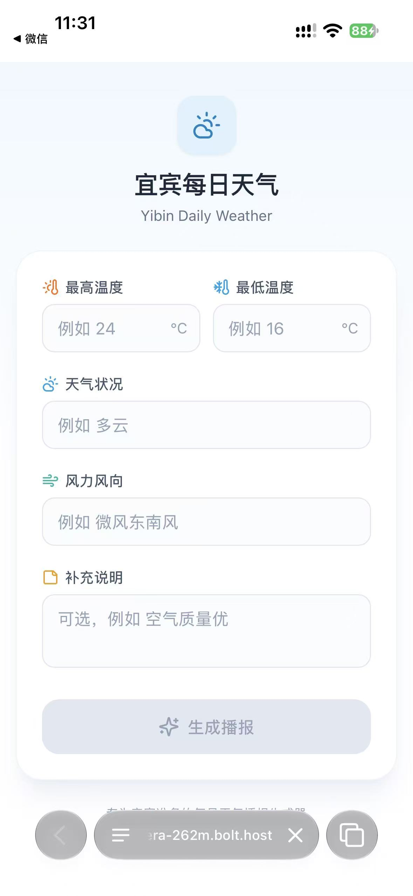

# yibin-weather

宜宾每日天气播报生成器 —— 商务转 FDE 的第一个练手项目。

作者：刘成业（[@liu-chengye](https://github.com/liu-chengye)）

## 在线体验

https://yibin-weather-genera-262m.bolt.host

第一版已发布（2026-11-25），移动端优先，打开即用。实测 HTTP 200，平均加载 1.7 秒。

## 它解决什么问题

每天早上要给家人发一段宜宾的天气提醒，手打一段话要五分钟，还容易漏掉穿衣和出行提醒。
做成工具之后：填五个字段，点一下生成，复制粘贴就能发。

## 功能

- 五个输入：最高温度、最低温度、天气状况、风力风向、补充说明
- 一键"生成播报"，输出四句结构：天气概括、穿衣建议、出行提醒、晚间收尾
- 文案口语化、控制在 140 字以内、不带表情符号
- 一键复制，直接粘到微信
- 纯前端单页，无登录、无后端、无数据库

## 状态

- [x] 第一版页面完成并发布（2026-11-25，Bolt.new 生成）
- [ ] 接入真实天气数据源，去掉手动输入
- [ ] 支持多城市切换（宜宾 / 成都 / 宝清）
- [x] 补充手机端截图到本 README（`assets/mobile-screenshot.jpg`）

## 技术说明

用 Bolt.new 的 Vibe Coding 方式生成：自然语言描述需求，AI 直接产出可运行代码，一键发布到 `.bolt.host`。
免费计划每天 300K token、每月 1M，本项目的首版加少量调整消耗在 100K 到 200K 之间。

## 学习日志

| 日期 | 内容 |
|---|---|
| 2026-11-24 | FDE 是什么：角色定义、能力模型、转型路径 → `notes/fde-01-what-is-fde.md` |
| 2026-11-25 | 零基础 Vibe Coding：做出第一个作品并部署 → `notes/fde-02-vibe-coding.md` |
| 2026-11-25 | GitHub 注册踩坑实录与解法 → `notes/github-signup-log.md` |

## 背景

3 年商务运营，做过投标全流程 103 个项目、合同与法务对接、逾期清收。
现在转 AI 方向，目标岗位 FDE（Forward Deployed Engineer），用这个仓库当作品集起点。
